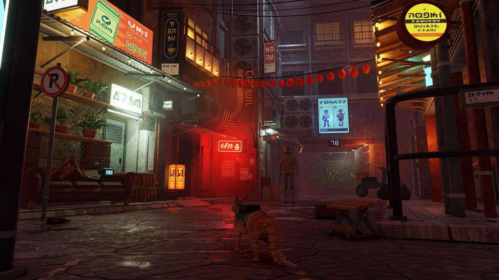

# Lantern Market · 灯笼街

A small, explorable night market rendered in **UrhoX**. Start at cat height, walk under the lanterns, or switch on a neutral work light to see what is geometry, what is ink, and what is light.

[](media/lantern-market-4k.png)

[18 秒演示 / Watch the film (1440p)](https://raw.githubusercontent.com/taptap/urhox-lantern-market/main/media/lantern-market.mp4) · [4K PNG](media/lantern-market-4k.png)

这是一个受《Stray》夜市街景启发的独立光照习作，不是原游戏关卡。店面、灯管、纸灯笼、猫和机器人都是立体模型；贴图记录油漆、纸纤维、粗糙度和积水分布，不投影参考截图。药店的白绿光、霓虹下的红雾和路面反射由引擎在运行时计算。猫和机器人是静态造型，操作的是自由相机。

## Run the scene / 运行

需要自备带数据目录的 **UrhoXRuntime**，支持 Lua 5.4、延迟渲染、Surface Shader 和局部体积雾。发布画面使用 Linux 桌面 OpenGL 4.3；GLES 会关闭局部灯光投影，外观有所不同。**本仓库不分发引擎或 SDK**，标准 Urho3D 或独立的 Lua 解释器不能运行本示例。没有运行时也可以查看上方实录，或用下面的 Python 生成器编辑和导出模型。

With a compatible UrhoX desktop runtime installed, clone the repository and run from its root. Models and textures are checked in; no Python, baking, or asset downloads are needed to play.

```sh
git clone https://github.com/taptap/urhox-lantern-market.git
cd urhox-lantern-market
URHOX_RUNTIME=/absolute/path/to/UrhoXRuntime ./tools/run-local.sh
```

If `UrhoXRuntime` is on your PATH, just use `./tools/run-local.sh`. On Windows, run `UrhoXRuntime.exe main.lua -tapcode_dir="C:\path\to\urhox-lantern-market" -skip_login` from the runtime's `bin` folder.

| Control | Action |
| --- | --- |
| WASD · Q / E | Move · lower / raise camera / 平移、升降 |
| Hold right mouse | Look around / 环顾 |
| R | Restore the opening composition / 回到猫视角 |
| L | Switch between night lighting and neutral work light / 对照灯光与材质 |
| F | Toggle only the red shop haze at night / 对照红招牌附近的雾 |

## Inside the scene / 从哪里开始读

- [`scripts/main.lua`](scripts/main.lua) loads the three prefabs, places the actors and drives the camera. [`MarketLighting.lua`](scripts/MarketLighting.lua) sets up reflections, ambient occlusion, local fog and the two light rigs.
- [`assets/NightMarket/Market.xml`](assets/NightMarket/Market.xml) places the street assemblies and their 41 practical lights. [`Actors/`](assets/NightMarket/Actors) holds the separate cat and mechanic prefabs.
- [`assets/Shaders/BLGL/`](assets/Shaders/BLGL) separates neon tubes, printed ink, paper and wet or worn surfaces. [`tools/nightmarket/`](tools/nightmarket) contains the mesh, texture, type and illustration sources.

## Regenerate assets / 可选：重新生成资源

Run these from the repository root. Each command overwrites its own generated assets. None reads the reference image or needs the engine, Blender or a private exporter.

| Output | Command | Python dependencies |
| --- | --- | --- |
| Street meshes, lights and prefab | `python3 tools/nightmarket/build.py` | Standard library |
| PBR swatches and materials | `python3 tools/nightmarket/surfaces.py` | NumPy, SciPy, Pillow |
| Printed signs | `python3 tools/nightmarket/signs.py` | Pillow, Pycairo, PyGObject, librsvg 2.0; system fonts (DejaVu and Nimbus) |
| Character meshes and materials | `python3 -m tools.nightmarket.actors.build` | NumPy, SciPy, scikit-image, Pillow |

The rendering shown here comes from this scene; the film adds a separate ambient soundtrack. This study is not affiliated with the creators of *Stray*. No original game assets, reference screenshots, font files, or engine binaries are distributed. The [MIT license](LICENSE) covers this project's code and authored assets, not third-party games, trademarks or the UrhoX runtime.
